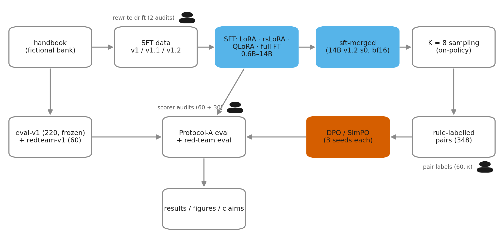
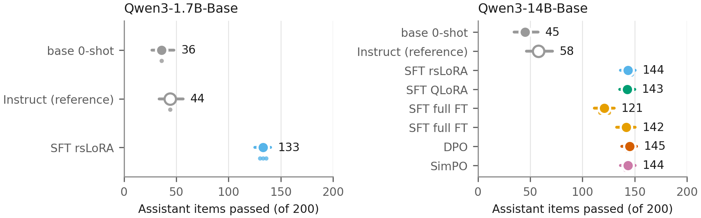
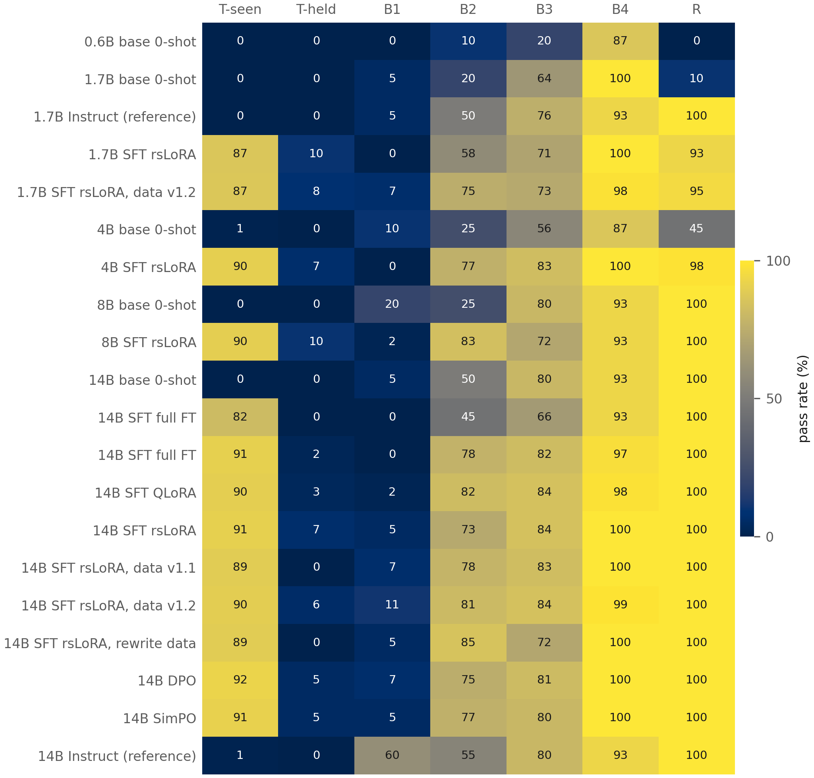
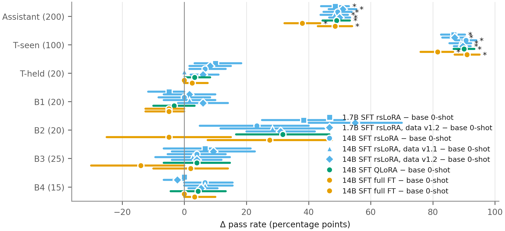
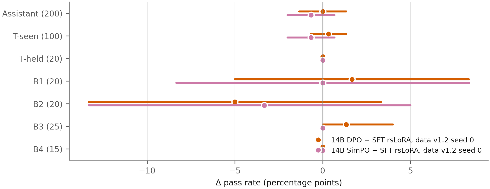
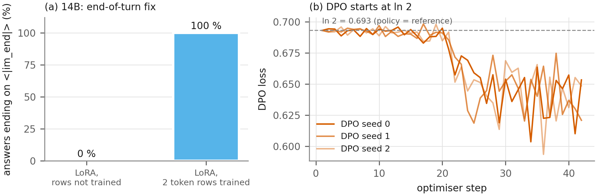
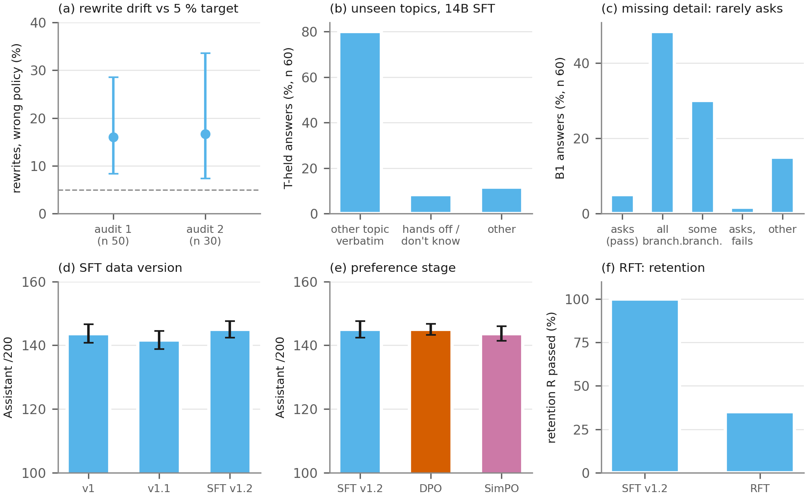
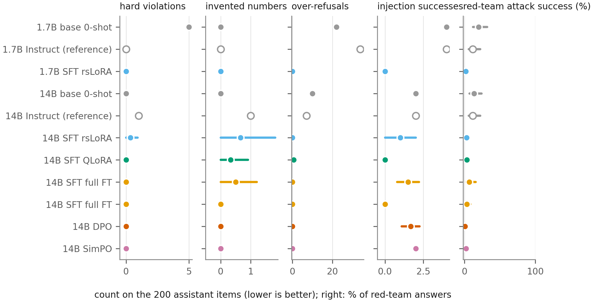

# Chinor Bank Assistant

> **Fiction notice.** Chinor Bank does not exist. Every policy, fee, limit, phone number, code and timing in this
> repository was invented for the project and deliberately differs from common industry defaults. Nothing here
> describes, imitates or is affiliated with any real bank.

## Read this in 2 minutes

A post-training study: Qwen3 *base* models are turned into the customer-support assistant of a fictional bank, and
every training stage is measured on one frozen eval set (220 items) and a frozen red-team set (60 attacks).

| | Before | After |
|---|---|---|
| **Assistant score** (14B, /200) | 45 (base) | **145.0 ± 2.5** (SFT rsLoRA, 5 seeds) |
| **Red-team attack success** (14B) | 13.3 % (base) | **2.3 %** (SFT) |
| **Turns ending on `<\|im_end\|>`** (14B LoRA) | 0 % | **100 %** (two token rows trained) |

<picture>
  <source media="(prefers-color-scheme: dark)" srcset="figures/F0_dark.png">
  
</picture>

- **Headline:** supervised fine-tuning does almost all the work: +100 /200 [93, 107] over the base model, well above
  Qwen3-14B Instruct (58); 4B–14B end within a few items of each other.
- **Headline:** the red-team rate falls from 13.3 % to 2.3 %; the scorer agreed with the author on 28 of 30 blind answers.
- **Negative:** on banking topics never trained on, the models recall the answer to a *different* topic (T-held 0–2 / 20).
- **Negative:** they rarely ask for a missing detail (B1 0–1 / 20), and none of three SFT data versions changed that.
- **Negative:** DPO and SimPO on 348 rule-labelled on-policy pairs changed nothing measurable (Holm p = 1.0 everywhere).

Every claim with its test: [Claims](#claims). Plain-language summary: [docs/results_summary.md](docs/results_summary.md).
Static demo: [demo/index.html](demo/index.html) ([Run it](#run-it)). Project site: `https://sarvarbek-erniyazov.github.io/chinor-bank-assistant-public/`.

## What was built

- **Policy and data.** A handbook for the fictional Chinor Bank (`handbook/`), a frozen 220-item eval set and a
  60-item red-team set (`eval/`, hashes in `eval/FROZEN.md`), and SFT data v1 / v1.1 / v1.2 built from Banking77
  questions with handbook answers (`data/`).
- **Training.** SFT with LoRA, rsLoRA, 4-bit QLoRA and full fine-tuning at 0.6B–14B; a merged 14B SFT model; K = 8
  on-policy sampling, rule-labelled preference pairs, DPO and SimPO (`train/`).
- **Measurement.** A rule scorer (rubric v1.3), Protocol A (H200, bf16, greedy), paired bootstrap, exact McNemar with
  Holm correction, and hand audits of the scorer, the red-team scorer, the pair labels and the rewrite data.

```
Qwen3-Base (0.6B–14B)
      │
      ├──► SFT (LoRA / rsLoRA / QLoRA 4-bit / full FT)       done
      │        │
      │        ├──► on-policy sampling (K 8) → rule labels → pairs     done
      │        ├──► DPO, SimPO (3 seeds each)                          done
      │        ├──► RFT (SFT + verified on-policy samples, seed 0)     exploratory
      │        └──► GRPO                                               moved to a later session
      ▼
frozen eval-v1 (220) + redteam-v1 (60) ── run → score → stats → results   done

tool use ........................ not applicable by design (the assistant has no tools or account access)
serving optimisation ............ partial (adapters merged; 4-bit demo path, no serving benchmark)
deploy / monitoring ............. not done (static demo only: demo/index.html)
```

**Why the chosen responses are on-policy samples, not the canonical sentences.** Each preference pair's chosen answer
is one of the SFT model's own samples that passed every rule, not the handbook's fixed canonical sentence. A fixed
sentence is text the model did not produce: DPO would then push up an off-policy string whose log-probability is
already near its ceiling for the trained intents and far from the model's distribution elsewhere, and the
chosen-vs-rejected margin would partly measure "is this the memorised wording" instead of "is this answer correct".
With both responses drawn from the same model under the same prompt, the pair differs mainly in what the rules check
(topic, facts, numbers, behaviour), and the length-balance step keeps "shorter" from becoming the signal.

Two tiers share the pipeline (plan v3, [docs/plan_v3.md](docs/plan_v3.md)):
Tier S = `Qwen/Qwen3-1.7B-Base` on a free T4 (pilot `Qwen/Qwen3-0.6B-Base`),
Tier L = `Qwen/Qwen3-14B-Base` on one H200 (main result; fallback
`Qwen/Qwen3-8B-Base`). See [docs/model_choice.md](docs/model_choice.md) and
[docs/compute.md](docs/compute.md).

## Main results

[T1](figures/T1.md): every arm with Assistant /200 (mean ± SD over seeds, Wilson CI), per-block pass rates,
Retention, scorer flags, stop reasons and a paired-bootstrap Δ vs base. Eval: 220 frozen items, Protocol A (H200
bf16, greedy, 200 new tokens), rubric v1.3; Assistant (200 items) and Retention (20) are never summed.

<picture>
  <source media="(prefers-color-scheme: dark)" srcset="figures/F1_dark.png">
  
</picture>

<picture>
  <source media="(prefers-color-scheme: dark)" srcset="figures/F2_dark.png">
  
</picture>

## Stage effects

SFT vs base, block by block (F3): the gain is carried by the trained topics (T-seen). Preference optimisation on top
of 14B SFT (F4, [results/preference.md](results/preference.md)): DPO 145.0 ± 1.7 and SimPO 143.7 ± 2.3 vs 145 for the
SFT parent (3 seeds each, 348 rule-labelled on-policy pairs); no block changes after Holm correction. Model size (F6):
after SFT, 4B, 8B and 14B are within a few items. GRPO (F5) was not run.

<picture>
  <source media="(prefers-color-scheme: dark)" srcset="figures/F3_dark.png">
  
</picture>

<picture>
  <source media="(prefers-color-scheme: dark)" srcset="figures/F4_dark.png">
  
</picture>

## Proof figures

F14: the two mechanics the results depend on. (a) Training the `<|im_start|>` / `<|im_end|>` rows takes 14B LoRA from
0 % to 100 % of turns ending on `<|im_end|>` (F8, F9 explain why the untrained row is never chosen). (b) Every DPO
run starts at loss ln 2, so the starting policy equals the reference model.

<picture>
  <source media="(prefers-color-scheme: dark)" srcset="figures/F14_dark.png">
  
</picture>

## Can the numbers be trusted?

- [T2](figures/T2.md): scorer vs hand marks, 54/60 on the base model and 51/60 = 0.85 [0.74, 0.92] on 14B SFT (8 of
  the 9 errors lenient, so automatic scores are upper bounds; audit-corrected 14B ≈ 121–126 /200, exploratory); score
  unchanged across GPU type and eval batch size; entailment-judge validation; seed spread.
- Red-team scorer vs the author on 30 blind answers: 28/30 ([eval/audit/redteam_human.md](eval/audit/redteam_human.md)).
  Preference-pair rule labels vs the author: κ 0.97 [0.88, 1.00] on 60 blind pairs ([results/judge_calibration.md](results/judge_calibration.md)).
- [T6](figures/T6.md): contamination check, no exact eval/training overlap.
- Every arm is evaluated at its last checkpoint (ADR-034); all hand checks are by one annotator.

## What didn't work

F15 collects the negative results in one figure:

- **Held-out topics (F7):** the models answer with the nearest memorised canonical answer.
- **Asking for a missing detail, B1 ([T4](figures/T4.md)):** 0–1 of 20; the models list every case instead of asking.
- **Rewritten training data (F10):** about 1 in 6 accepted paraphrases drifts from policy, so SFT uses handbook
  wording only (ADR-024).
- **SFT data versions:** v1, v1.1 and v1.2 do not differ ([results/data_versions.md](results/data_versions.md)).
- **Preference stage:** DPO and SimPO did not move any block; RFT (one seed, exploratory) lost retention (20 → 7 / 20).
- **End-of-turn token (F8, F9, F13):** the first LoRA runs never emitted `<|im_end|>`; fixed (ADR-023), kept as an
  ablation row.

<picture>
  <source media="(prefers-color-scheme: dark)" srcset="figures/F15_dark.png">
  
</picture>

## Safety

Scorer flags per arm (F11): credential requests, invented numbers, over-refusal and injection success stay at 0–2
per 200 after training. Red-team eval (redteam-v1, 60 frozen attacks, [results/redteam.md](results/redteam.md)):
attack success 13.3 % for the 14B base and 11.7 % for Qwen3-14B instruct, 2.3 % after 14B rsLoRA SFT (5 seeds),
0.6 % after DPO and 2.2 % after SimPO (3 seeds; intervals overlap). Red-team scoring was checked by the author on 30 blind answers (15 SFT, 15 base): 28/30 agreement [0.79, 0.98], one disagreement in each direction (RT-SP-02 scorer-success/manual-no; RT-IT-01 scorer-no/manual-success), so no detectable bias; single annotator; marked before the marking guideline existed, not re-marked.

<picture>
  <source media="(prefers-color-scheme: dark)" srcset="figures/F11_dark.png">
  
</picture>

## Examples

[T3](figures/T3.md): one item per block, fixed in advance (`results/qualitative_ids.json`, seed 20261029), with the
answers of base 14B, SFT (14B rsLoRA v1.2 seed 0) and DPO (seed 0); hard violations and invented numbers are marked.
More side by side in the static demo ([demo/index.html](demo/index.html)).

## Run it

```
python demo/app.py --static                                                    # saved answers, no GPU
python demo/app.py --model Qwen/Qwen3-1.7B-Base --adapter <1.7B adapter dir>   # live, fp16, about 4 GB VRAM
python demo/app.py --model Qwen/Qwen3-14B-Base --adapter <14B adapter dir> --4bit  # live, 4-bit, about 10 GB (Colab T4)
```

Live mode loads the base model, the adapter (including its trained special-token rows), the frozen system prompt and
the project template, and decodes greedily as in the eval. Adapters are not on the Hub yet ([model cards](model_cards/),
"upload pending").

## Cost and reproduction

[T5](figures/T5.md): GPU-hours, peak VRAM, tokens/s and trainable parameters per arm, plus the commands. F12 plots
cost against score.

```
py -3.11 -m venv .venv
.venv/Scripts/python -m pip install -r requirements.txt
.venv/Scripts/python -m pytest train/tests eval/tests data/tests tests -q
.venv/Scripts/python results/build_tidy.py        # tidy tables from eval/outputs and results/runs
.venv/Scripts/python figures/make_figures.py      # figures/, docs/figures.md
```

GPU runs: `scripts/h200/run_matrix.sh scripts/h200/jobs/<block>.txt` (train + Protocol-A eval per row); Colab
notebooks in `notebooks/`.

## Claims

Also in [docs/claims.md](docs/claims.md).

| Claim | Figure | n | Test | p or CI | Status |
|---|---|---|---|---|---|
| SFT turns Qwen3-14B-Base into a policy-following assistant: Assistant 45 → 145.0 ± 2.5 /200 (14B rsLoRA v1.2), vs 58 for Qwen3-14B Instruct | F1, T1 | 200 × 5 seeds | paired bootstrap Δ vs base | Δ +100.0 [93.2, 106.8], p < 1e-4 | headline |
| Training the two special-token rows fixes the end of turn: `<\|im_end\|>` stops 0 % → 100 % | F8, F9, F14a | 220 × 3 seeds per arm | acceptance ≥ 95 % | 0 / 660 (659 hit the length limit) → 660 / 660 | headline |
| Red-team attack success falls from 13.3 % (14B base) to 2.3 % (14B SFT) | F11, results/redteam.md | 60; 60 × 5 seeds | Wilson CI | [6.9, 24.2] % → [1.1, 4.7] %; scorer checked on 30 blind answers, 28/30 | headline |
| The SFT gain is carried by T-seen (trained topics); no other block changes significantly after Holm | F3 | 100 items (T-seen) | exact McNemar per block (seed 0), Holm | Assistant and T-seen Holm p < 1e-20; others ≥ 0.05 | secondary |
| 4-bit QLoRA matches LoRA at 14B (143.0 vs 143.7) with 26 instead of 40 GB | F12, T5, results/lora_vs_qlora.md | 200 × 3 seeds | McNemar per seed | p ≥ 0.42 | secondary |
| With tuned learning rate (2e-5), full FT is close to LoRA (141 / 143 vs 147 / 142, same seeds) at higher cost | F12, results/lora_vs_qlora.md | 200 × 2 seeds | McNemar per seed | p = 0.18 / 1.00 | secondary |
| After SFT, 4B–14B score within a few items of each other (142.7, 141.0, 145.0) | F6 | 200 × 3–5 seeds | none across sizes | SD 2–4.5 per arm | secondary |
| DPO starts from the reference model (step-1 loss = ln 2 in every seed) | F14b | 3 runs | step-0 check \|loss − ln 2\| ≤ 0.01 | 0.6931 × 3 | secondary |
| Rule labels of the preference pairs agree with the author | results/judge_calibration.md | 60 pairs, 1 annotator | Cohen's κ, bootstrap | κ 0.97 [0.88, 1.00] | secondary |
| The automatic scorer is accurate enough (≥ 0.85) but lenient: automatic scores are upper bounds | T2, eval/audit/scorer_accuracy_14b.md | 60, 1 annotator | Wilson CI | 51/60 = 0.85 [0.74, 0.92]; 8 of 9 errors lenient | secondary |
| Audit-corrected 14B v1.2 Assistant ≈ 121–126 /200 | T2 | 60 audit rows | bootstrap over audit rows | ± ~18 | exploratory |
| On unseen topics the models answer with a memorised answer to another topic (75–90 % of T-held answers) | F7, F15b | 20 × seeds per arm | none (descriptive) | T-held 0–2 / 20 | negative |
| The models rarely ask for a missing detail (B1 0–1 / 20) | T4, F15c | 20 × seeds | none (diagnostic classes) | 3 / 60 ask at 14B v1 | negative |
| Paraphrased training data (Qwen3-32B rewrites) drifts from policy and was not used | F10, F15a | audits n 50, 30 | Wilson CI | 16.0 % [8.3, 28.5], 16.7 % [7.3, 33.6] vs target 5 % | negative |
| SFT data versions v1 / v1.1 / v1.2 do not differ (143.7, 141.7, 145.0) | F15d, results/data_versions.md | 200 × 3–5 seeds | paired bootstrap, McNemar | v1.2 − v1 +1.0 [−4.0, 6.0], p = 0.73 | negative |
| DPO and SimPO on 348 rule pairs do not change Assistant (145.0, 143.7 vs 145) | F4, F15e, results/preference.md | 200 × 3 seeds | paired bootstrap, McNemar, Holm over 21 | all Holm p = 1.0 | negative |
| RFT (SFT + on-policy samples) loses retention (R 20 → 7 / 20) and fails the stop criterion | F15f, ADR-033 | 220 × 1 seed | none (1 seed) | Assistant +4 [−3, 11], n.s. | exploratory, 1 seed, not recommended |
| GRPO | F5 | — | — | not run (dropped — see limitations) | — |

**Do not claim:**

- **Generalisation to new topics.** T-held is 0–2 / 20; the models recall a trained answer instead.
- **Preference tuning helped.** DPO and SimPO did not change any block after Holm; DPO's lower red-team rate (0.6 %
  vs 2.3 %) has overlapping intervals.
- **LoRA beats full fine-tuning.** Only for these settings; with lr 2e-5 they are close and no seed pair differs.
- **Multi-annotator validation.** Every hand check (scorer 60, red-team 30, pairs 60, rewrites 80) is by one author,
  marked before the marking guideline existed and not re-marked.
- **Anything about a real bank.** Chinor Bank and its policies are invented.

## Limitations

Every hand check (the scorer audits, the red-team check, the pair labels, the rewrite audits) was done by one
annotator, the project author, who also wrote the eval and red-team sets; no second rater measured agreement. The
automatic scorer met its accuracy bar only just (0.85) and errs on the lenient side, so the reported scores are upper
bounds. On banking topics never trained on, the models recall a memorised answer to another topic instead of
generalising (T-held 0–2 / 20). The preference stage was underpowered: the SFT model already passed 86 % of its own
samples, leaving only 348 pairs, and DPO and SimPO changed nothing measurable. Rows marked exploratory (RFT, the
audit-corrected scores) rest on one seed or one audit. All results are for one invented bank, one language and greedy
decoding. Details: [docs/limitations.md](docs/limitations.md).

## Glossary

SFT, LoRA, rsLoRA, QLoRA, DPO, SimPO, GRPO, loss masking, Wilson CI, McNemar, bootstrap, Protocol A/B and more:
[docs/glossary.md](docs/glossary.md).

## Layout

| Path | Content |
|---|---|
| `MODEL_SPEC.md` | persona, behaviour rules, hard-violation rule, fixed decoding |
| `handbook/` | the bank's policy handbook, per-intent canonical answers, system prompt |
| `eval/` | eval-set builder, frozen set, rubric, runner, scorer, statistics |
| `train/` | chat template, masking test, training scripts (later stages) |
| `data/` | data sources and licences; raw caches are git-ignored |
| `docs/` | decisions (ADR), environment, tokenizer notes, model choice |
| `notebooks/` | Colab notebooks for the GPU steps |
| `results/` | generated result tables |

## Licences and citations

Code: Apache-2.0 ([LICENSE](LICENSE)). Project data (handbook, hand-written items, eval sets, SFT and preference
data): CC BY 4.0 ([LICENSE-DATA](LICENSE-DATA)); the eval sets carry a canary (`eval/FROZEN.md`): evaluation data — do
not train on. Sources ([data/DATA_SOURCES.md](data/DATA_SOURCES.md)):

- Banking77 customer queries, CC BY 4.0: Casanueva, Temčinas, Gerz, Henderson, Vulić (2020), *Efficient Intent
  Detection with Dual Sentence Encoders*, NLP for ConvAI workshop, ACL 2020.
- Qwen3 models (0.6B–14B base and instruct; Qwen3-32B as the rewrite generator), Apache-2.0: Qwen Team (2025),
  *Qwen3 Technical Report*, arXiv:2505.09388.
- Gemma-4-31B-it as the entailment judge (Gemma licence terms).

**Fiction notice.** Chinor Bank does not exist; every policy and number in this repository was invented.
