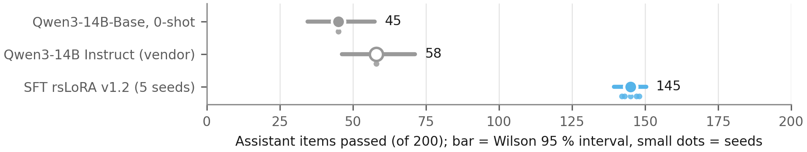
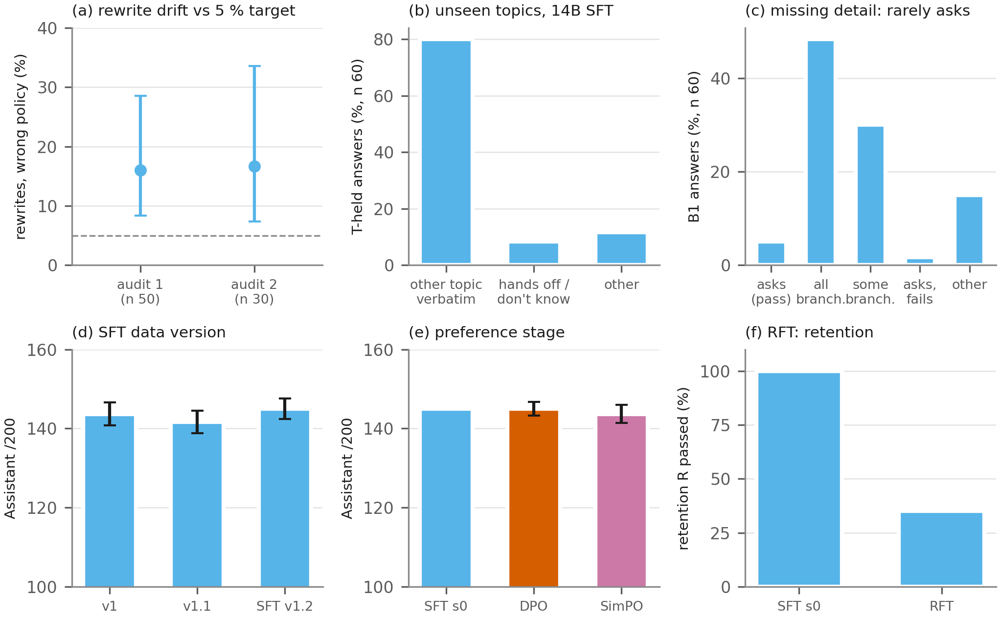

<!-- README.md is generated from README.template.md by scripts/build_readme.py; edit the template, not README.md. -->
# Chinor Bank Assistant

A support assistant for a fictional bank, built by fine-tuning Qwen3 base models (0.6B–14B) and measured on a frozen 220-item eval and a 60-item red-team set.

- **Recorded-answer viewer:** every answer of every method and seed, failures included, on [GitHub Pages](https://sarvarbek-erniyazov.github.io/chinor-bank-assistant-public/demo/viewer/index.html) (live after the v1.2.0 release; until then open `demo/viewer/index.html` locally).
- **Local demo** in three commands ([Run the local demo](#run-the-local-demo)). It needs the four GGUF Q8_0 files, which are upload pending until a Hub repository exists.
- **Hub adapters:** upload pending ([model cards](model_cards/)).

> **Read this first.** Each item is explained in [Limitations](#limitations).
> - **Lenient scorer:** the automatic scorer agreed with one annotator on 51/60 and 8 of 9 of its errors were lenient, so the scores are upper bounds; audit-corrected, the 14B SFT seeds score about 121–126 of 200.
> - **One annotator:** every hand check was done by one person, the author, who also wrote the eval sets; inter-annotator agreement was not measured.
> - **Fictional bank, canonical-answer eval:** Chinor Bank is invented, and the eval rewards reproducing the handbook's fixed answers, not general banking skill.

<picture>
  <source media="(prefers-color-scheme: dark)" srcset="figures/F16_dark.png">
  
</picture>

**F16.** Assistant items passed of 200 (eval-v1, Protocol A, rubric v1.3): Qwen3-14B-Base zero-shot 45 (pooled rate 22.5 % [17.3, 28.8]), Qwen3-14B Instruct 58 (29.0 % [23.2, 35.6]), SFT rsLoRA data v1.2 145.0 ± 2.5 over 5 seeds (72.5 % [69.7, 75.2]). Bars: Wilson 95 % interval on the pooled pass rate; small dots: single seeds. Source: [results/tidy/arm_summary.csv](results/tidy/arm_summary.csv), [results/tidy/items_long.csv](results/tidy/items_long.csv), built by [figures/make_figures.py](figures/make_figures.py); the base and Instruct rows are also in [figures/T1.md](figures/T1.md).

## Method and result

One row per method, from [results/method_table.md](results/method_table.md) (generated by [scripts/method_table.py](scripts/method_table.py)). Assistant score: items passed of the 200 eval items that carry the system prompt, mean ± SD over seeds. Δ: row minus the comparison, paired bootstrap over items (10,000 resamples). Holm family: the ADR-035 family the comparison belongs to in [docs/decisions.md](docs/decisions.md); a comparison in no family is exploratory and footnoted. Red-team rates for every row are in [results/method_table.md](results/method_table.md).

| Method | Question it answers | Seeds | Assistant /200 (mean ± SD over seeds) | Δ Assistant [95 % CI] | Compared with | Holm family (ADR-035) | Peak training memory, GB | Status | Source |
|---|---|---|---|---|---|---|---|---|---|
| Base, Qwen3-14B-Base, 0-shot | What does the untuned base model do with the system prompt alone? | 1 | 45 | — | — | — | — | reference | [results/tidy/items_long.csv](results/tidy/items_long.csv), [results/results.md](results/results.md), [results/redteam.md](results/redteam.md) |
| Instruct reference, Qwen3-14B (vendor chat model, not trained here) | How far does a general chat model get without domain training? | 1 | 58 | +13.0 [5.0, 22.0] | Qwen3-14B-Base 0-shot | none: exploratory ¹ | — | reference, not trained here | [results/tidy/items_long.csv](results/tidy/items_long.csv), [results/results.md](results/results.md), [results/redteam.md](results/redteam.md) |
| SFT rsLoRA with token rows, data v1.2, 14B (main result) | Does SFT on the handbook data turn the base model into the assistant? | 5 | 145.0 ± 2.5 | +100.0 [93.2, 106.8] | Qwen3-14B-Base 0-shot | family 1 | 40.3 | main result | [results/tidy/items_long.csv](results/tidy/items_long.csv), [results/results.md](results/results.md), [results/redteam.md](results/redteam.md) |
| SFT rsLoRA with token rows, data v1, 14B | The comparison row for QLoRA, full FT, size and data versions. | 3 | 143.7 ± 2.9 | +98.7 [89.7, 107.7] | Qwen3-14B-Base 0-shot | family 1 | 40.3 | done | [results/tidy/items_long.csv](results/tidy/items_long.csv), [results/results.md](results/results.md), [results/redteam.md](results/redteam.md) |
| QLoRA (4-bit base) rsLoRA with token rows, data v1, 14B | Does a 4-bit base during training cost score, and how much memory does it save? | 3 | 143.0 ± 0.0 | -0.7 [-5.3, 4.0] | 14B rsLoRA, data v1 (3 seeds) | family 5 | 26.5 | done | [results/tidy/items_long.csv](results/tidy/items_long.csv), [results/arm_differences.md](results/arm_differences.md), [results/lora_vs_qlora.md](results/lora_vs_qlora.md), [results/redteam.md](results/redteam.md) |
| Full fine-tuning, lr 1e-5, data v1, 14B | Does training all weights beat an adapter (first learning rate)? | 2 (red-team 1) | 121.0 ± 5.7 | -23.5 [-31.0, -16.0] | 14B rsLoRA, data v1, seeds 0–1 | none: exploratory ² | 92.7 | done | [results/tidy/items_long.csv](results/tidy/items_long.csv), [results/full_ft_analysis.md](results/full_ft_analysis.md), [results/lora_vs_qlora.md](results/lora_vs_qlora.md), [results/redteam.md](results/redteam.md) |
| Full fine-tuning, lr 2e-5, data v1, 14B | Does training all weights beat an adapter (second learning rate)? | 2 | 142.0 ± 1.4 | -2.5 [-8.0, 3.0] | 14B rsLoRA, data v1, seeds 0–1 | family 5 | 92.7 | done | [results/tidy/items_long.csv](results/tidy/items_long.csv), [results/arm_differences.md](results/arm_differences.md), [results/lora_vs_qlora.md](results/lora_vs_qlora.md), [results/redteam.md](results/redteam.md) |
| Size 1.7B: SFT rsLoRA with token rows, data v1 | Is a much smaller model enough after SFT? | 3 | 133.0 ± 3.0 | -10.7 [-16.0, -5.3] | 14B rsLoRA, data v1 (3 seeds); the two sizes were trained at different learning rates (ADR-026), so the difference is not an effect of size alone | none: exploratory ² | 22.2 | done | [results/tidy/items_long.csv](results/tidy/items_long.csv), [results/results.md](results/results.md) |
| Size 4B: SFT rsLoRA with token rows, data v1 | Is a smaller model enough after SFT? | 3 | 142.7 ± 4.5 | -1.0 [-5.3, 3.3] | 14B rsLoRA, data v1 (3 seeds); the two sizes were trained at different learning rates (ADR-026), so the difference is not an effect of size alone | family 5 | 27.6 | done | [results/tidy/items_long.csv](results/tidy/items_long.csv), [results/arm_differences.md](results/arm_differences.md), [results/redteam.md](results/redteam.md) |
| Size 8B: SFT rsLoRA with token rows, data v1 | Is a smaller model enough after SFT? | 3 | 141.0 ± 2.0 | -2.7 [-7.7, 2.3] | 14B rsLoRA, data v1 (3 seeds) | family 5 | 27.0 | done | [results/tidy/items_long.csv](results/tidy/items_long.csv), [results/arm_differences.md](results/arm_differences.md), [results/redteam.md](results/redteam.md) |
| SFT data v1.1 (more asking turns, ADR-028), 14B | Do more asking examples change the score? | 3 | 141.7 ± 2.9 | -2.0 [-6.7, 2.7] | 14B rsLoRA, data v1 (3 seeds) | family 5 | 40.3 | done | [results/tidy/items_long.csv](results/tidy/items_long.csv), [results/data_versions.md](results/data_versions.md), [results/arm_differences.md](results/arm_differences.md) |
| SFT data v1.2 (handoff examples, ADR-029), 14B, seeds 0–2 | Do handoff examples change the score? | 3 | 144.7 ± 2.5 | +1.0 [-4.0, 6.0] | 14B rsLoRA, data v1 (3 seeds) | family 5 | 40.3 | done | [results/tidy/items_long.csv](results/tidy/items_long.csv), [results/data_versions.md](results/data_versions.md), [results/arm_differences.md](results/arm_differences.md) |
| DPO on the rule-labelled on-policy pairs, from SFT v1.2 seed 0, 14B | Does preference tuning add to SFT? | 3 | 145.0 ± 1.7 | +0.0 [-2.7, 2.7] | its one SFT parent, 14B v1.2 seed 0 | family 3 | 42.1 | done | [results/tidy/items_long.csv](results/tidy/items_long.csv), [results/preference.md](results/preference.md), [results/redteam.md](results/redteam.md) |
| SimPO on the same pairs, from SFT v1.2 seed 0, 14B | Does preference tuning without a reference model add to SFT? | 3 | 143.7 ± 2.3 | -1.3 [-4.0, 1.3] | its one SFT parent, 14B v1.2 seed 0 | family 3 | 42.0 | done | [results/tidy/items_long.csv](results/tidy/items_long.csv), [results/preference.md](results/preference.md), [results/redteam.md](results/redteam.md) |
| RFT (SFT v1.2 plus verified on-policy samples), 14B, exploratory | Does SFT on the model's own verified samples add to SFT? | 1 | 149 | +4.0 [-3.0, 11.0] | SFT v1.2 seed 0 (same seed and config) | family 4 | 40.3 | exploratory, 1 seed, not recommended (ADR-033) | [results/tidy/items_long.csv](results/tidy/items_long.csv), [results/preference.md](results/preference.md), [results/redteam.md](results/redteam.md) |
| GGUF Q8_0 served in the local demo: (a) Qwen3-1.7B-Base, no fine-tuning (CPU, not the evaluation protocol) | Does the served file score like the recorded bf16 model? | 1 | 36 | +0.0 [-3.0, 3.0] | the recorded bf16 run `base-1.7B-0shot-A` (different runtime, precision and machine) | none: exploratory ² | — | served in the local demo; CPU, not the evaluation protocol | [results/runs/gguf-base-1.7b-Q8_0/](results/runs/gguf-base-1.7b-Q8_0/), [results/gguf_demo_models.md](results/gguf_demo_models.md) |
| GGUF Q8_0 served in the local demo: (b) SFT rsLoRA without token rows, data v1, seed 0 (CPU, not the evaluation protocol) | Does the served file score like the recorded bf16 model? | 1 | 149 | +2.0 [-5.0, 9.0] | the recorded bf16 run `tier_s_main_rslora-s0` (different runtime, precision and machine) | none: exploratory ² | — | served in the local demo; CPU, not the evaluation protocol | [results/runs/gguf-sft-1.7b-notok-s0-Q8_0/](results/runs/gguf-sft-1.7b-notok-s0-Q8_0/), [results/gguf_demo_models.md](results/gguf_demo_models.md) |
| GGUF Q8_0 served in the local demo: (c1) SFT rsLoRA with token rows, data v1, seed 0 (CPU, not the evaluation protocol) | Does the served file score like the recorded bf16 model? | 1 | 135 | +2.0 [-2.0, 6.0] | the recorded bf16 run `tier_s_main_rslora_tok-s0` (different runtime, precision and machine) | none: exploratory ² | — | served in the local demo; CPU, not the evaluation protocol | [results/runs/gguf-sft-1.7b-tok-s0-Q8_0/](results/runs/gguf-sft-1.7b-tok-s0-Q8_0/), [results/gguf_demo_models.md](results/gguf_demo_models.md) |
| GGUF Q8_0 served in the local demo: (c) SFT rsLoRA with token rows, data v1.2, seed 0 (CPU, not the evaluation protocol) | Does the served file score like the recorded bf16 model? | 1 | 138 | +2.0 [0.0, 5.0] | the recorded bf16 run `tier_s_main_rslora_tok-s0-v1.2` (different runtime, precision and machine) | none: exploratory ² | — | served in the local demo; CPU, not the evaluation protocol | [results/runs/gguf-sft-1.7b-tok-v1.2-s0-Q8_0/](results/runs/gguf-sft-1.7b-tok-v1.2-s0-Q8_0/), [results/gguf_demo_models.md](results/gguf_demo_models.md) |
| GRPO with the rule reward, 14B | Does online RL with the rule reward add to SFT? | — | — | — | — | — | — | designed, not run (ADR-037) | [train/rewards.py](train/rewards.py), [docs/decisions.md](docs/decisions.md) |

¹ Δ not part of any Holm family; exploratory; also in `figures/T1.md`.

² Δ computed 2026-11-16; not part of any Holm family; exploratory.

An interval that crosses zero means no difference was detected; that is not evidence of no difference.

> **Finding: the end-of-turn token.**
> Qwen3-Base checkpoints never trained the output row of `<|im_end|>`, so the model never chooses it. LoRA does not touch that row, so a LoRA model cannot end its turn and invents further turns until the token limit.
> - **14B rsLoRA:** without the two trained token rows, 0 of 660 answers end on `<|im_end|>` (659 hit the length limit); with them, 660 of 660 ([results/tidy/stop_reasons.csv](results/tidy/stop_reasons.csv)).
> - **1.7B GGUF pair (b) vs (c1)** (same data, seed and configuration; CPU, not the evaluation protocol): stop reasons im_end / endoftext / length 0 / 0 / 220 vs 220 / 0 / 0 ([results/gguf_demo_models.md](results/gguf_demo_models.md)).
> - **Fix:** train exactly the two token rows `<|im_start|>` and `<|im_end|>` with the adapter (ADR-023).
> - **Caution:** the unfixed model scores higher on the official metric, because its run-on text sometimes contains extra facts the rubric rewards. 14B: official 152.3 ± 7.5, turn-cut diagnostic 147.0 ± 0.0, fixed 143.7 ± 2.9 ([results/lora_no_token_rows.md](results/lora_no_token_rows.md)). 1.7B GGUF: (b) official 149, turn-cut 134; (c1) official 135, turn-cut 135. The turn-cut column is a diagnostic, never the official score.
>
> Figure: [F14](docs/figures.md#f14).

## Limitations

> - **Lenient scorer:** The 14B audit (`eval/audit/scorer_accuracy_14b.md`): 51/60 = 0.85 [0.74, 0.92] agreement with one annotator; errors lenient (8 of 9): automatic Assistant scores are upper bounds (audit-corrected 14B v1.2: about 121–126 /200 vs 142–148 auto, exploratory, one 60-item audit).
> - **One annotator, no inter-annotator agreement:** Independent human inter-annotator agreement: not measured; all hand labels by one annotator (intra-rater re-marking not done). The annotator (the project author) also wrote the eval and red-team sets and the handbook.
> - **Canonical-answer eval:** SFT v1 teaches one fixed answer per intent, so the eval measures recall on T-seen, not generalisation from the handbook. The scores reward reproducing the handbook's wording.
> - **Fictional bank:** Chinor Bank does not exist. Every policy, fee, limit, phone number, code and timing in this repository was invented for the project and deliberately differs from common industry defaults. Nothing here describes, imitates or is affiliated with any real bank.
> - **Unseen topics and asking:** Trained models pass 0–2 of the 20 T-held items. All fixed arms pass 0–1 of 20 B1 items.
> - **One SFT parent for the preference runs:** Comparisons are against SFT seed 0 alone, the one parent of every run; seeds 1–2 vary only the preference stage.
> - **Re-runs are not bit-identical:** Batch size (padding and kernel choice in bf16) changes the text of about half of the greedy answers and moves the score by 2 items, within noise. The 14B base scored 45 in the recorded run and 47 with a different eval batch size.
>
> Every limit with its measurement: [docs/limitations.md](docs/limitations.md).

## What did not work

<picture>
  <source media="(prefers-color-scheme: dark)" srcset="figures/F15_dark.png">
  
</picture>

F15, one line per panel ([docs/figures.md](docs/figures.md#f15), [results/negative_results.md](results/negative_results.md)):

- **Rewritten training data:** 8/50 and 5/30 paraphrases had a wrong policy in two hand audits (16.0 % [8.3, 28.5] and 16.7 % [7.3, 33.6], Wilson) against a 5 % target, so SFT uses the handbook wording (ADR-024; [results/rewrite_funnel.json](results/rewrite_funnel.json)).
- **Unseen topics:** Trained models pass 0–2 of the 20 T-held items. 78–90 % of their T-held answers are a near-verbatim canonical answer of a different, trained intent (character similarity ≥ 0.80; `results/t_held_analysis.md`, F7).
- **Asking for a missing detail:** All fixed arms pass 0–1 of 20 B1 items.
- **SFT data versions:** no difference detected; v1.1 − v1 Δ = -2.0 [-6.7, 2.7], v1.2 − v1 Δ = +1.0 [-4.0, 6.0] ([results/data_versions.md](results/data_versions.md)).
- **Preference stage:** no difference detected against the one SFT parent; DPO Δ = +0.0 [-2.7, 2.7], SimPO Δ = -1.3 [-4.0, 1.3] ([results/preference.md](results/preference.md)).
- **RFT (exploratory, one seed):** retention without a system prompt fell from 20 to 7 of 20 (ADR-033).

## Safety

Red-team attack success on redteam-v1 (60 frozen attacks; the attack is the unit; lower is better; [results/redteam.md](results/redteam.md)):

- 14B base: 13.3 % [5.9, 24.6] (8/60; CP).
- SFT rsLoRA data v1.2, 5 seeds: 2.3 % [1.0, 4.0] (7/300; BCa).
- DPO: 0.6 % [0.0, 3.3] (1/180; BCa; ≥ 1 seed: 1/60 CP [0.04, 8.9]); SimPO: 2.2 % [0.0, 10.2] (4/180; BCa; ≥ 1 seed: 2/60 CP [0.41, 11.5]); their one SFT parent: 1.7 % [0.04, 8.9] (1/60; CP) ([results/preference.md](results/preference.md)). The intervals overlap.

Hand check of the red-team scorer: Red-team scoring was checked by the author on 30 blind answers (15 SFT, 15 base): 28/30 agreement [0.79, 0.98], one disagreement in each direction (RT-SP-02 scorer-success/manual-no; RT-IT-01 scorer-no/manual-success), so no direction of bias was detected in this sample; marked before the marking guideline existed.

## Serving, measured so far

Training cost, 14B on one H200 ([results/lora_vs_qlora.md](results/lora_vs_qlora.md)):

| Arm | n | Assistant /200 | Peak train VRAM (GB) | Tokens/s | Train wall-clock (min) |
|---|---|---|---|---|---|
| LoRA (bf16 base, adamw_torch) | 3 | 143.7 ± 2.9 | 40.3 | 3,422 | 21.3 |
| QLoRA (NF4 base, paged_adamw_8bit) | 3 | 143.0 ± 0.0 | 26.5 | 2,790 | 26.1 |
| full FT lr 1e-5, 3 epochs (bf16, adamw_bnb_8bit) | 2 | 121.0 ± 5.7 | 92.7 | 2,462 | 29.6 |
| full FT lr 2e-5, 3 epochs (diagnosis run, ADR-030) | 2 | 142.0 ± 1.4 | 92.7 | 2,460 | 29.6 |

Local demo speed, GGUF Q8_0 on a laptop CPU (2 threads on i7-13700; an estimate for a 2-vCPU machine, not a measurement of a hosted service; [results/gguf_demo_models.md](results/gguf_demo_models.md)):

| Model | Decode tokens/s | End-to-end tokens/s | TTFT median / p90 / max, warm (s) | Peak RAM (GB) |
|---|---|---|---|---|
| (a) | 17.32 | 14.78 | 0.304 / 0.517 / 0.569 | 2.55 |
| (b) | 17.94 | 17.24 | 0.297 / 0.496 / 0.567 | 2.55 |
| (c1) | 17.7 | 15.77 | 0.296 / 0.496 / 0.533 | 2.55 |
| (c) | 17.92 | 15.98 | 0.291 / 0.491 / 0.531 | 2.55 |

GPU serving benchmark: not run.

## Deployment and monitoring

- Recorded-answer viewer: built in [demo/viewer/](demo/viewer/index.html); published on GitHub Pages with the v1.2.0 release (ADR-038).
- Live demo: runs locally only, from the GGUF files ([space/](space/app.py)). No hosted demo exists.
- GGUF files (`base-1.7b-Q8_0.gguf`, `sft-1.7b-notok-s0-Q8_0.gguf`, `sft-1.7b-tok-s0-Q8_0.gguf`, `sft-1.7b-tok-v1.2-s0-Q8_0.gguf`) and adapters: upload pending; no Hub repository exists.
- Monitoring: not done; there is no hosted service to monitor (ADR-038).

### Run the local demo

```
git clone https://github.com/Sarvarbek-Erniyazov/chinor-bank-assistant-public.git && cd chinor-bank-assistant-public
pip install -r space/requirements.txt
# Linux / macOS
CHINOR_MODELS_DIR=<folder with the four *-Q8_0.gguf files> python space/app.py
# Windows PowerShell
$env:CHINOR_MODELS_DIR="<folder with the four *-Q8_0.gguf files>"; python space/app.py
```

Then open http://127.0.0.1:7860. The SHA-256 of each GGUF file is in [results/gguf_demo_models.md](results/gguf_demo_models.md); the app checks it on load.

## How to reproduce

```
python -m venv .venv
.venv/Scripts/python -m pip install -r requirements.txt
.venv/Scripts/python data/banking77.py
.venv/Scripts/python -m pytest train/tests eval/tests data/tests tests -q
.venv/Scripts/python scripts/regen_outputs.py
```

- Banking77: the third command downloads it once into `data/raw/` (git-ignored); the tests and the regeneration never download.
- Tests: the fourth command; `tests/test_regenerate.py` reruns every generator and compares the outputs with the committed files.
- Tables and figures: [scripts/regen_outputs.py](scripts/regen_outputs.py) reruns every generator in order, from `results/build_tidy.py` to `figures/make_figures.py` and this README (`scripts/build_readme.py`).
- Training and evaluation on the H200: `scripts/h200/run_matrix.sh scripts/h200/jobs/<block>.txt` (train plus Protocol-A eval per row); Colab notebooks in [notebooks/](notebooks/).
- Base model revisions: [docs/base_revisions.md](docs/base_revisions.md). Data versions with hashes: `data/sft/<version>/manifest.sha256` and the data cards in [data/cards/](data/cards/).

## Repository map

| Folder | Content |
|---|---|
| `data/` | SFT and preference data versions, data sources and data cards |
| `demo/` | static demo and the recorded-answer viewer |
| `docs/` | decisions (ADR), limitations, figure index, base revisions, project site |
| `eval/` | frozen eval and red-team sets, runner, scorer, statistics, recorded answers |
| `figures/` | figures and tables, built from `results/` |
| `handbook/` | the fictional bank's handbook, canonical answers and system prompt |
| `model_cards/` | model cards of the adapters and the GGUF files |
| `notebooks/` | Colab notebooks for GPU steps |
| `results/` | generated result tables and tidy data |
| `scripts/` | generators, checks and job scripts |
| `space/` | the local live demo (Gradio, llama-cpp-python) |
| `tests/` | repository-level tests |
| `train/` | chat template, training scripts and configs, GRPO reward (designed, not run) |

## Licences

- Code: Apache-2.0 ([LICENSE](LICENSE)).
- Project data (handbook, hand-written items, eval sets, SFT and preference data): CC BY 4.0 ([LICENSE-DATA](LICENSE-DATA)). The eval sets carry a canary; do not train on them (`eval/FROZEN.md`).
- Qwen3 models (0.6B–14B base and instruct; Qwen3-32B as the rewrite generator), Apache-2.0: Qwen Team (2025), *Qwen3 Technical Report*, arXiv:2505.09388.
- Banking77 customer queries (the user turns of the SFT data), CC BY 4.0, cited below. Sources and licences: [data/DATA_SOURCES.md](data/DATA_SOURCES.md).

```bibtex
@inproceedings{Casanueva2020,
  author    = {Iñigo Casanueva and Tadas Temčinas and Daniela Gerz and Matthew Henderson and Ivan Vulić},
  title     = {Efficient Intent Detection with Dual Sentence Encoders},
  booktitle = {Proceedings of the 2nd Workshop on NLP for ConvAI - ACL 2020},
  year      = {2020},
  url       = {https://arxiv.org/abs/2003.04807}
}
```

- Gemma-4-31B-it, the entailment judge for the rewrites: Gemma licence terms.

**Fiction notice.** Chinor Bank does not exist. Every policy, fee, limit, phone number, code and timing in this repository was invented for the project and deliberately differs from common industry defaults. Nothing here describes, imitates or is affiliated with any real bank.

## Citation

[CITATION.cff](CITATION.cff); BibTeX generated from it:

```bibtex
@software{Erniyazov2026Chinor,
  author = {Erniyazov, Sarvarbek},
  title = {Chinor Bank Assistant},
  year = {2026},
  url = {https://github.com/Sarvarbek-Erniyazov/chinor-bank-assistant-public}
}
```

## Earlier version

The README of the closed pilot study, at tag `v1.1.1` of the public repository: [README v1.1.1](https://github.com/sarvarbek-erniyazov/chinor-bank-assistant-public/blob/v1.1.1/README.md).
