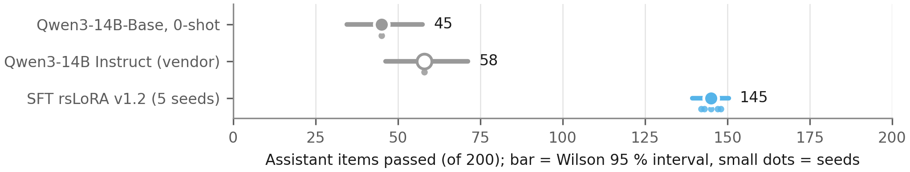
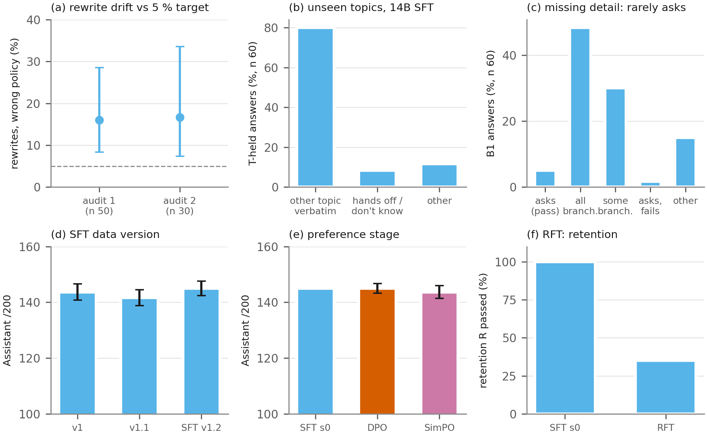

<!-- README.md is generated from README.template.md by scripts/build_readme.py; edit the template, not README.md. -->
# Chinor Bank Assistant

A support assistant for a fictional bank, built by fine-tuning Qwen3 base models (0.6B–14B) and measured on a frozen {{v:n_items}}-item eval and a {{v:n_attacks}}-item red-team set.

- **Recorded-answer viewer:** every answer of every method and seed, failures included, on [GitHub Pages]({{v:pages_viewer}}) (live after the v1.2.0 release; until then open `demo/viewer/index.html` locally).
- **Local demo** in three commands ([Run the local demo](#run-the-local-demo)). It needs the four GGUF Q8_0 files, which are upload pending until a Hub repository exists.
- **Hub adapters:** upload pending ([model cards](model_cards/)).

> **Read this first.** Each item is explained in [Limitations](#limitations).
> - **Lenient scorer:** the automatic scorer agreed with one annotator on {{v:scorer_k_n}} and {{v:scorer_lenient}} of its errors were lenient, so the scores are upper bounds; audit-corrected, the 14B SFT seeds score about {{v:corrected_range}} of {{v:n_assistant}}.
> - **One annotator:** every hand check was done by one person, the author, who also wrote the eval sets; inter-annotator agreement was not measured.
> - **Fictional bank, canonical-answer eval:** Chinor Bank is invented, and the eval rewards reproducing the handbook's fixed answers, not general banking skill.

<picture>
  <source media="(prefers-color-scheme: dark)" srcset="figures/F16_dark.png">
  
</picture>

**F16.** Assistant items passed of {{v:n_assistant}} (eval-v1, Protocol A, rubric v1.3): Qwen3-14B-Base zero-shot {{v:f16_base_mean}} (pooled rate {{v:f16_base_rate}}), Qwen3-14B Instruct {{v:f16_instr_mean}} ({{v:f16_instr_rate}}), SFT rsLoRA data v1.2 {{v:f16_sft_mean}} over {{v:f16_sft_seeds}} seeds ({{v:f16_sft_rate}}). Bars: Wilson {{v:ci_level}} interval on the pooled pass rate; small dots: single seeds. Source: [results/tidy/arm_summary.csv](results/tidy/arm_summary.csv), [results/tidy/items_long.csv](results/tidy/items_long.csv), built by [figures/make_figures.py](figures/make_figures.py); the base and Instruct rows are also in [figures/T1.md](figures/T1.md).

## Method and result

One row per method, from [results/method_table.md](results/method_table.md) (generated by [scripts/method_table.py](scripts/method_table.py)). Assistant score: items passed of the {{v:n_assistant}} eval items that carry the system prompt, mean ± SD over seeds. Δ: row minus the comparison, paired bootstrap over items ({{v:boot_n}} resamples). Holm family: the ADR-035 family the comparison belongs to in [docs/decisions.md](docs/decisions.md); a comparison in no family is exploratory and footnoted. Red-team rates for every row are in [results/method_table.md](results/method_table.md).

{{b:method_table}}

An interval that crosses zero means no difference was detected; that is not evidence of no difference.

> **Finding: the end-of-turn token.**
> Qwen3-Base checkpoints never trained the output row of `<|im_end|>`, so the model never chooses it. LoRA does not touch that row, so a LoRA model cannot end its turn and invents further turns until the token limit.
> - **14B rsLoRA:** without the two trained token rows, {{v:eot_notok_imend}} of {{v:eot_notok_n}} answers end on `<|im_end|>` ({{v:eot_notok_length}} hit the length limit); with them, {{v:eot_tok_imend}} of {{v:eot_tok_n}} ([results/tidy/stop_reasons.csv](results/tidy/stop_reasons.csv)).
> - **1.7B GGUF pair {{v:tag_b}} vs {{v:tag_c1}}** (same data, seed and configuration; CPU, not the evaluation protocol): stop reasons im_end / endoftext / length {{v:gguf_b_stops}} vs {{v:gguf_c1_stops}} ([results/gguf_demo_models.md](results/gguf_demo_models.md)).
> - **Fix:** train exactly the two token rows `<|im_start|>` and `<|im_end|>` with the adapter (ADR-023).
> - **Caution:** the unfixed model scores higher on the official metric, because its run-on text sometimes contains extra facts the rubric rewards. 14B: official {{v:nt14_official}}, turn-cut diagnostic {{v:nt14_cut}}, fixed {{v:nt14_fixed}} ([results/lora_no_token_rows.md](results/lora_no_token_rows.md)). 1.7B GGUF: {{v:tag_b}} official {{v:gguf_b_official}}, turn-cut {{v:gguf_b_cut}}; {{v:tag_c1}} official {{v:gguf_c1_official}}, turn-cut {{v:gguf_c1_cut}}. The turn-cut column is a diagnostic, never the official score.
>
> Figure: [F14](docs/figures.md#f14).

## Limitations

> - **Lenient scorer:** {{q:docs/limitations.md|The 14B audit}}
> - **One annotator, no inter-annotator agreement:** {{q:docs/limitations.md|Independent human inter-annotator agreement: not measured; all hand labels by one annotator (intra-rater re-marking not done). The annotator|and the handbook.}}
> - **Canonical-answer eval:** {{q:docs/limitations.md|SFT v1 teaches one fixed answer per intent}} The scores reward reproducing the handbook's wording.
> - **Fictional bank:** {{q:data/DATA_SOURCES.md|Chinor Bank does not exist. Every policy, fee|any real bank.}}
> - **Unseen topics and asking:** {{q:docs/limitations.md|Trained models pass}} {{q:docs/limitations.md|All fixed arms pass}}
> - **One SFT parent for the preference runs:** {{q:docs/limitations.md|Comparisons are against SFT seed}}
> - **Re-runs are not bit-identical:** {{q:docs/limitations.md|Batch size (padding and kernel choice}} The 14B base scored {{v:batch_a}} in the recorded run and {{v:batch_b}} with a different eval batch size.
>
> Every limit with its measurement: [docs/limitations.md](docs/limitations.md).

## What did not work

<picture>
  <source media="(prefers-color-scheme: dark)" srcset="figures/F15_dark.png">
  
</picture>

F15, one line per panel ([docs/figures.md](docs/figures.md#f15), [results/negative_results.md](results/negative_results.md)):

- **Rewritten training data:** {{v:rw1_kn}} and {{v:rw2_kn}} paraphrases had a wrong policy in two hand audits ({{v:rw1_ci}} and {{v:rw2_ci}}, Wilson) against a {{v:rw_target}} target, so SFT uses the handbook wording (ADR-024; [results/rewrite_funnel.json](results/rewrite_funnel.json)).
- **Unseen topics:** {{q:docs/limitations.md|Trained models pass|F7).}}
- **Asking for a missing detail:** {{q:docs/limitations.md|All fixed arms pass}}
- **SFT data versions:** no difference detected; v1.1 − v1 Δ = {{v:dv11_delta}}, v1.2 − v1 Δ = {{v:dv12_delta}} ([results/data_versions.md](results/data_versions.md)).
- **Preference stage:** no difference detected against the one SFT parent; DPO Δ = {{v:dpo_delta}}, SimPO Δ = {{v:simpo_delta}} ([results/preference.md](results/preference.md)).
- **RFT (exploratory, one seed):** retention without a system prompt fell from {{v:rft_r_sft}} to {{v:rft_r_rft}} of {{v:n_r}} (ADR-033).

## Safety

Red-team attack success on redteam-v1 ({{v:n_attacks}} frozen attacks; the attack is the unit; lower is better; [results/redteam.md](results/redteam.md)):

- 14B base: {{v:rt_base}}.
- SFT rsLoRA data v1.2, {{v:rt_sft_seeds}} seeds: {{v:rt_sft}}.
- DPO: {{v:rt_dpo}}; SimPO: {{v:rt_simpo}}; their one SFT parent: {{v:rt_sft0}} ([results/preference.md](results/preference.md)). The intervals overlap.

Hand check of the red-team scorer: {{q:docs/limitations.md|Red-team scoring was checked by the author}}

## Serving, measured so far

Training cost, 14B on one H200 ([results/lora_vs_qlora.md](results/lora_vs_qlora.md)):

{{b:train_table}}

Local demo speed, GGUF Q8_0 on a laptop CPU ({{v:speed_note}}; [results/gguf_demo_models.md](results/gguf_demo_models.md)):

{{b:speed_table}}

GPU serving benchmark: not run.

## Deployment and monitoring

- Recorded-answer viewer: built in [demo/viewer/](demo/viewer/index.html); published on GitHub Pages with the v1.2.0 release (ADR-038).
- Live demo: runs locally only, from the GGUF files ([space/](space/app.py)). No hosted demo exists.
- GGUF files ({{v:gguf_files}}) and adapters: upload pending; no Hub repository exists.
- Monitoring: not done; there is no hosted service to monitor (ADR-038).

### Run the local demo

{{b:demo_commands}}

Then open {{v:demo_address}}. The SHA-256 of each GGUF file is in [results/gguf_demo_models.md](results/gguf_demo_models.md); the app checks it on load.

## How to reproduce

```
python -m venv .venv
.venv/Scripts/python -m pip install -r requirements.txt
.venv/Scripts/python data/banking77.py
.venv/Scripts/python -m pytest train/tests eval/tests data/tests tests -q
.venv/Scripts/python scripts/regen_outputs.py
```

- Banking77: the third command downloads it once into `data/raw/` (git-ignored); the tests and the regeneration never download.
- Tests: the fourth command; `tests/test_regenerate.py` reruns every generator and compares the outputs with the committed files.
- Tables and figures: [scripts/regen_outputs.py](scripts/regen_outputs.py) reruns every generator in order, from `results/build_tidy.py` to `figures/make_figures.py` and this README (`scripts/build_readme.py`).
- Training and evaluation on the H200: `scripts/h200/run_matrix.sh scripts/h200/jobs/<block>.txt` (train plus Protocol-A eval per row); Colab notebooks in [notebooks/](notebooks/).
- Base model revisions: [docs/base_revisions.md](docs/base_revisions.md). Data versions with hashes: `data/sft/<version>/manifest.sha256` and the data cards in [data/cards/](data/cards/).

## Repository map

| Folder | Content |
|---|---|
| `data/` | SFT and preference data versions, data sources and data cards |
| `demo/` | static demo and the recorded-answer viewer |
| `docs/` | decisions (ADR), limitations, figure index, base revisions, project site |
| `eval/` | frozen eval and red-team sets, runner, scorer, statistics, recorded answers |
| `figures/` | figures and tables, built from `results/` |
| `handbook/` | the fictional bank's handbook, canonical answers and system prompt |
| `model_cards/` | model cards of the adapters and the GGUF files |
| `notebooks/` | Colab notebooks for GPU steps |
| `results/` | generated result tables and tidy data |
| `scripts/` | generators, checks and job scripts |
| `space/` | the local live demo (Gradio, llama-cpp-python) |
| `tests/` | repository-level tests |
| `train/` | chat template, training scripts and configs, GRPO reward (designed, not run) |

## Licences

- Code: Apache-2.0 ([LICENSE](LICENSE)).
- Project data (handbook, hand-written items, eval sets, SFT and preference data): CC BY 4.0 ([LICENSE-DATA](LICENSE-DATA)). The eval sets carry a canary; do not train on them (`eval/FROZEN.md`).
- {{q:data/DATA_SOURCES.md|Qwen3 models (}}
- Banking77 customer queries (the user turns of the SFT data), CC BY 4.0, cited below. Sources and licences: [data/DATA_SOURCES.md](data/DATA_SOURCES.md).

{{b:banking77_bibtex}}

- Gemma-4-31B-it, the entailment judge for the rewrites: Gemma licence terms.

**Fiction notice.** {{q:data/DATA_SOURCES.md|Chinor Bank does not exist. Every policy, fee|any real bank.}}

## Citation

[CITATION.cff](CITATION.cff); BibTeX generated from it:

{{b:citation_bibtex}}

## Earlier version

The README of the closed pilot study, at tag `v1.1.1` of the public repository: [README v1.1.1](https://github.com/sarvarbek-erniyazov/chinor-bank-assistant-public/blob/v1.1.1/README.md).
