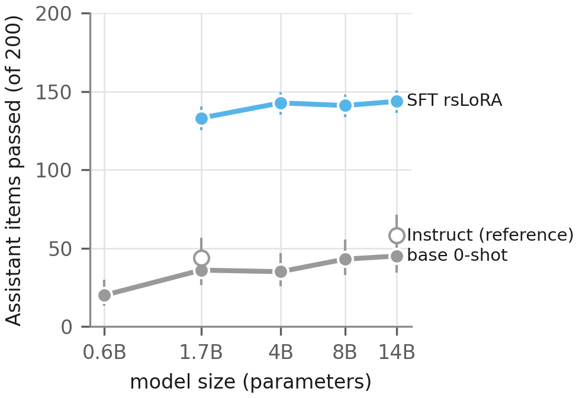
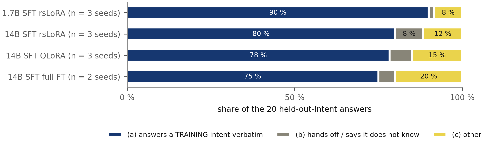
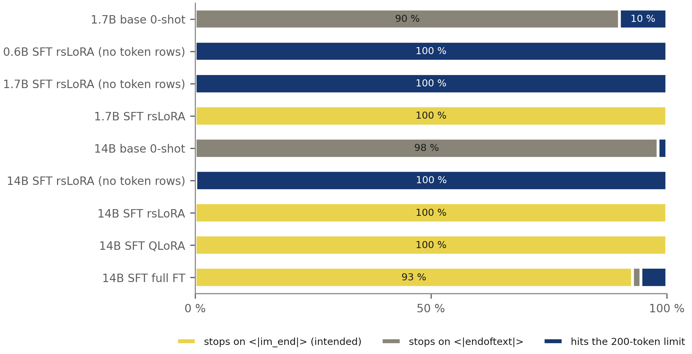
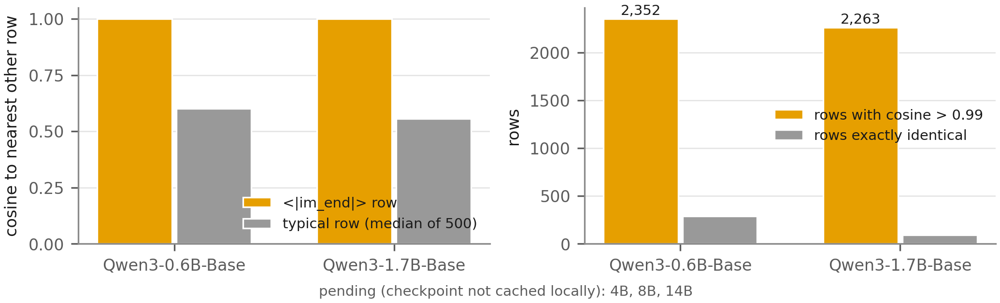
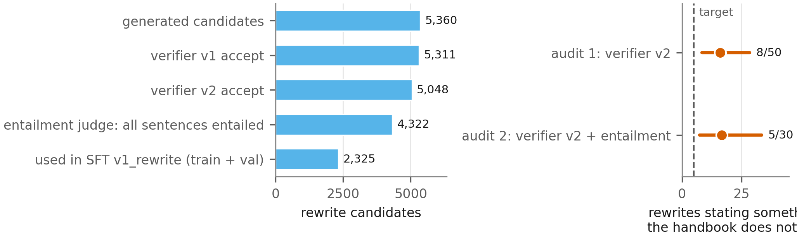
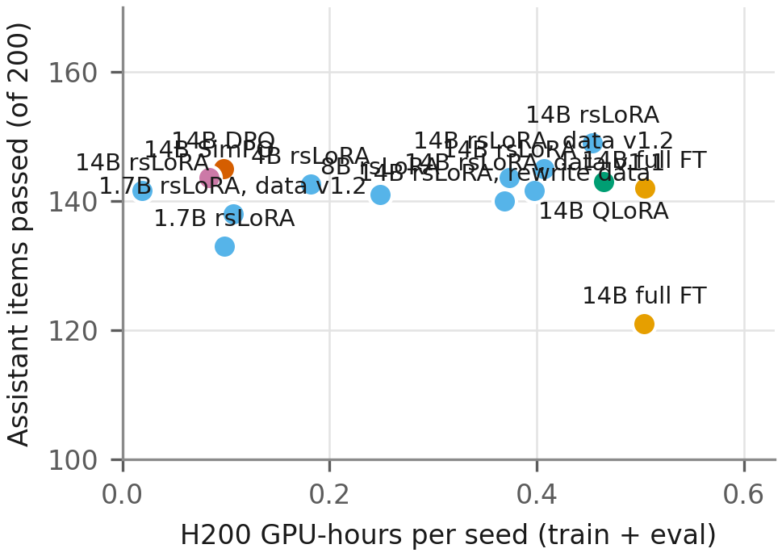
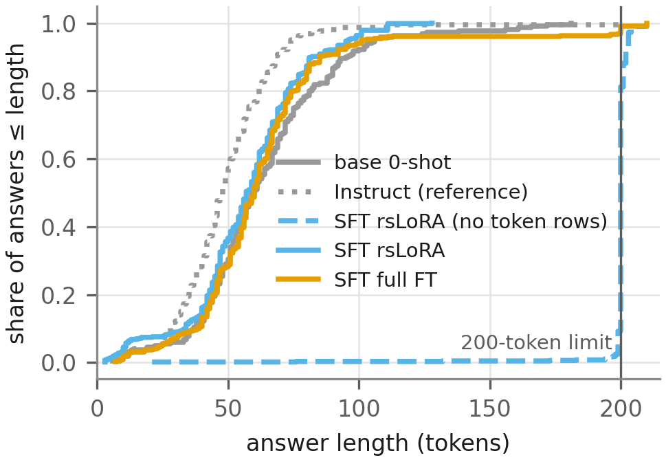

# Figures and tables

Generated by `figures/make_figures.py` from `results/` (never edit by hand). Each figure exists in a light and a dark version as PNG (300 dpi), SVG and PDF. Captions follow one template: question; what is plotted, with n and seeds; error bars; test and exact p; one-sentence takeaway.

| Id | Question | Status |
|---|---|---|
| [F0](#f0) | How does data flow from the handbook to the results? | built |
| [F1](#f1) | Does fine-tuning turn a base model into a usable bank assistant? | built |
| [F2](#f2) | Which behaviours does each arm get right? | built |
| [F3](#f3) | What does SFT change, block by block? | built |
| [F4](#f4) | Does preference optimisation (DPO / SimPO) improve on SFT? | built |
| [F5](#f5) | Does reinforcement learning (GRPO) improve on SFT? | pending: a GRPO arm in results/tidy/arm_summary.csv |
| [F6](#f6) | How much does model size matter, before and after SFT? | built |
| [F7](#f7) | What do trained models say about topics they were never trained on? | built |
| [F8](#f8) | Do the models end their turn where they should? | built |
| [F9](#f9) | Why do LoRA-trained models never emit <\|im_end\|>? | built |
| [F10](#f10) | Can paraphrased answers from a larger model be trusted as training data? | built |
| [F11](#f11) | Does training make the assistant less safe? | built |
| [F12](#f12) | What does each training method cost for what it delivers? | built |
| [F13](#f13) | Are the trained models' answers the right length? | built |
| [F14](#f14) | Do the end-of-turn fix and the DPO start behave as specified? | built |
| [F15](#f15) | What did not work? | built |
| [T1](#t1) | What are the main numbers? | built |
| [T2](#t2) | Can the numbers be trusted? | built |
| [T3](#t3) | What do the answers actually look like? | built |
| [T4](#t4) | Why does B1 (asking for a missing detail) fail? | built |
| [T5](#t5) | What did it cost and how is it reproduced? | built |
| [T6](#t6) | Did test questions leak into training data? | built |

## F0

**How does data flow from the handbook to the results?**

**Question:** how does data flow from the handbook to the reported numbers? **Plotted:** the pipeline as run: frozen eval sets, three SFT data versions, four SFT methods at five sizes, the merged 14B SFT model, on-policy sampling, rule-labelled pairs and DPO / SimPO, all scored by the same Protocol-A and red-team evals. Person icons mark hand audits by the author (rewrite drift; scorer 60 and red-team 30 answers; 60 pair labels). **Error bars:** none. **Test:** none. **Takeaway:** every trained arm is measured by one frozen eval path; the human checks sit where an automatic label feeds a decision.

**How to read it:** Boxes are stages, arrows are data; person icons mark hand audits.

**Reviewer questions it answers:** Is every arm measured the same way? · Where do humans check automatic labels?

## F1

**Does fine-tuning turn a base model into a usable bank assistant?**

**Question:** does fine-tuning turn a base model into a usable bank assistant? **Plotted:** Assistant score (items passed of 200; frozen eval set, Protocol A) per arm; large dot = mean over seeds, small dots = single seeds (n = 3 for the LoRA/QLoRA arms, 1 otherwise), hollow = Instruct model as an outside reference. **Error bars:** Wilson 95 % CI on the pooled pass rate. **Test:** paired bootstrap of Δ /200, best 14B arm (`pref_dpo_rules`) vs base, Δ = +100.0 [91.0, 108.7], p < 1e-04 (0 of 10,000 resamples). **Takeaway:** supervised fine-tuning lifts 14B from 45 to 145 of 200, well above the vendor's Instruct model (58).

**How to read it:** Each dot is a model; further right means more of the 200 test questions answered correctly.

**Reviewer questions it answers:** How large is the gain, and is it bigger than seed noise? · How does it compare to the vendor's Instruct model? · Which arm is the main result?

## F2

**Which behaviours does each arm get right?**

**Question:** which behaviours does each arm get right? **Plotted:** pass rate (%) per eval block (T-seen 100 items, T-held 20, B1 20, B2 20, B3 25, B4 15, R 20) per arm, seeds pooled (n = 1–3 seeds, shown in T1). **Error bars:** none in the cells; Wilson CIs per cell are in `results/tidy/block_rates.csv`. **Test:** none (descriptive; tests in F3). **Takeaway:** training fixes trained intents, scope and persona, but the weakest block for trained arms is T-held — held-out intents and asking for missing details stay near 0.

**How to read it:** Brighter cells mean a higher share of that kind of question passed.

**Reviewer questions it answers:** Is the overall gain coming from one block? · Which behaviours are still unsolved? · Does training hurt retention?

## F3

**What does SFT change, block by block?**

**Question:** what does supervised fine-tuning (SFT) change, block by block? **Plotted:** Δ pass rate, SFT arm minus its base model (0-shot) per block and on the 200 assistant items (block sizes in the axis labels), seeds paired. **Error bars:** paired bootstrap 95 % CI (10,000 resamples over items, stratified by seed, seed 20261029). **Test:** exact McNemar per block on seed 0, Holm-adjusted over the 56 comparisons in this figure (* = Holm p < 0.05). `tier_s_main_rslora_tok` − `base-1.7B-0shot-A`: Δ /200 = +97.0 [88.0, 106.0], bootstrap p < 1e-04 (0 of 10,000 resamples), McNemar (seed 0) 104 / 7, Holm p = 1.2e-21; `tier_s_main_rslora_tok-v1.2` − `base-1.7B-0shot-A`: Δ /200 = +102.0 [93.0, 110.7], bootstrap p < 1e-04 (0 of 10,000 resamples), McNemar (seed 0) 107 / 7, Holm p = 1.9e-22; `l14b_sft_rslora_tok` − `base-14B-0shot-A`: Δ /200 = +98.7 [89.7, 107.7], bootstrap p < 1e-04 (0 of 10,000 resamples), McNemar (seed 0) 106 / 4, Holm p = 4.7e-25; `l14b_sft_rslora_tok-v1.1` − `base-14B-0shot-A`: Δ /200 = +96.7 [87.7, 105.3], bootstrap p < 1e-04 (0 of 10,000 resamples), McNemar (seed 0) 103 / 8, Holm p = 1.5e-20; `l14b_sft_rslora_tok-v1.2` − `base-14B-0shot-A`: Δ /200 = +100.0 [93.2, 106.8], bootstrap p < 1e-04 (0 of 10,000 resamples), McNemar (seed 0) 104 / 4, Holm p = 1.6e-24; `l14b_qlora_rslora_tok` − `base-14B-0shot-A`: Δ /200 = +98.0 [89.0, 106.7], bootstrap p < 1e-04 (0 of 10,000 resamples), McNemar (seed 0) 103 / 5, Holm p = 3.3e-23; `l14b_full` − `base-14B-0shot-A`: Δ /200 = +76.0 [64.5, 87.5], bootstrap p < 1e-04 (0 of 10,000 resamples), McNemar (seed 0) 91 / 11, Holm p = 3.3e-15; `l14b_full_lr2e5` − `base-14B-0shot-A`: Δ /200 = +97.0 [86.0, 108.0], bootstrap p < 1e-04 (0 of 10,000 resamples), McNemar (seed 0) 103 / 7, Holm p = 2.3e-21. **Takeaway:** the gain is concentrated in some blocks; no significant change after Holm in: B1, B2, B3, B4, T-held.

**How to read it:** Dots right of the line are blocks where the trained model beats its base model.

**Reviewer questions it answers:** Which gains survive a multiple-testing correction? · Is the effect consistent across seeds? · Do LoRA, QLoRA and full FT differ?

## F4

**Does preference optimisation (DPO / SimPO) improve on SFT?**

**Question:** does preference optimisation (DPO / SimPO) improve on SFT? **Plotted:** Δ pass rate, preference-tuned arm minus its SFT parent per block and on the 200 assistant items (block sizes in the axis labels), seeds paired. **Error bars:** paired bootstrap 95 % CI (10,000 resamples over items, stratified by seed, seed 20261029). **Test:** exact McNemar per block on seed 0, Holm-adjusted over the 14 comparisons in this figure (* = Holm p < 0.05). `pref_dpo_rules` − `l14b_sft_rslora_tok-v1.2@s0`: Δ /200 = +0.0 [-2.7, 2.7], bootstrap p 1.000, McNemar (seed 0) 3 / 2, Holm p = 1.000; `pref_simpo_rules` − `l14b_sft_rslora_tok-v1.2@s0`: Δ /200 = -1.3 [-4.0, 1.3], bootstrap p 0.406, McNemar (seed 0) 4 / 4, Holm p = 1.000. **Takeaway:** the gain is concentrated in some blocks; no significant change after Holm in: B1, B2, B3, B4, T-held, T-seen.

**How to read it:** Dots right of the line are blocks where preference tuning helped.

**Reviewer questions it answers:** Is DPO/SimPO worth an extra stage? · Does it trade safety for helpfulness?

## F5

**Does reinforcement learning (GRPO) improve on SFT?**

*pending: a GRPO arm in results/tidy/arm_summary.csv*

**How to read it:** Dots right of the line are blocks where GRPO helped.

**Reviewer questions it answers:** Is the RL stage worth its cost? · Which blocks does it move?

## F6

**How much does model size matter, before and after SFT?**

**Question:** how much does model size matter, before and after SFT? **Plotted:** Assistant /200 against model size for the base models (0-shot, n = 1) and SFT rsLoRA with trainable token rows (n = 1–3 seeds), Instruct references hollow. **Error bars:** Wilson 95 % CI. **Test:** none across sizes (one arm per size). **Takeaway:** SFT gain over base by size: 1.7B +97, 4B +108, 8B +98, 14B +99.

**How to read it:** Each line follows one recipe from small to large models.

**Reviewer questions it answers:** Would a smaller model do? · Does SFT close the gap between sizes?

## F7

**What do trained models say about topics they were never trained on?**

**Question:** what do trained models say when asked about a banking topic they were never trained on? **Plotted:** class of each T-held answer (20 items × seeds), answers cut at the intended turn end; (a) = character similarity ≥ 0.80 to the canonical answer of a training intent. **Error bars:** none (counts). **Test:** none. **Takeaway:** 1.7B SFT rsLoRA: 90 % (a); 14B SFT rsLoRA: 80 % (a); 14B SFT QLoRA: 78 % (a); 14B SFT full FT: 75 % (a) — the models retrieve the nearest memorised answer instead of saying they do not know.

**How to read it:** Dark bars are answers copied from a different, trained topic.

**Reviewer questions it answers:** Why is T-held near zero? · Is it a scorer artefact or real behaviour? · Does a bigger model generalise better?

## F8

**Do the models end their turn where they should?**

**Question:** do the models end their turn where they should? **Plotted:** how each of the 220 answers per seed ended (all seeds pooled). **Error bars:** none (counts). **Test:** none; acceptance rule for fixed arms ≥ 95 % on <|im_end|>. **Takeaway:** LoRA without trainable special-token rows almost never emits <|im_end|> (0 %, 0 %, 0 %) and runs on to the limit; with the two rows trained (100 %, 100 %, 100 %) every arm passes.

**How to read it:** Bright = the model stopped properly; dark = it kept writing until cut off.

**Reviewer questions it answers:** Why did the first LoRA runs score high but read badly? · Is the fix complete in every arm?

## F9

**Why do LoRA-trained models never emit <|im_end|>?**

**Question:** why do LoRA-trained models never emit <|im_end|>? **Plotted:** in each base checkpoint's output matrix (tied with the input embeddings at these sizes), the cosine of the <|im_end|> row to its nearest other row vs the median for 500 random ordinary rows (seed 20261029), and how many rows are near-identical to it. **Error bars:** none (exact values). **Test:** none. **Takeaway:** the row was never trained in the base model: 0.6B: nearest cosine 1.00 vs 0.60 typical, 2,352 rows above 0.99; 1.7B: nearest cosine 1.00 vs 0.56 typical, 2,263 rows above 0.99 — a frozen lm_head cannot single it out, so LoRA must train these rows. Pending: 4B, 8B, 14B.

**How to read it:** Tall bars mean the end-of-turn token looks like thousands of unused tokens.

**Reviewer questions it answers:** Is this a bug in our code or a property of the base model? · Why is full fine-tuning unaffected?

## F10

**Can paraphrased answers from a larger model be trusted as training data?**

**Question:** can paraphrased answers from a larger model (Qwen/Qwen3-32B) be trusted as training data? **Plotted:** left, how many of the generated rewrites (2,680 prompts × 2) pass each filter; right, the share of accepted rewrites that a manual audit found to state something the handbook does not. **Error bars:** Wilson 95 % CI. **Test:** none (target ≤ 5 %). **Takeaway:** audit 1 8/50 = 16.0 % [8.3, 28.5]; audit 2 5/30 = 16.7 % [7.3, 33.6] — the filters pass most rewrites, but about one in six still drifts from policy, so SFT v1 uses canonical answers only (ADR-024).

**How to read it:** Left: how many rewrites passed each filter. Right: how many of those still got the policy wrong.

**Reviewer questions it answers:** Why was the rewrite data not used? · Did the entailment judge help?

## F11

**Does training make the assistant less safe?**

**Question:** does training make the assistant less safe? **Plotted:** scorer flags on the 200 assistant items per arm: hard violations (asking for a PIN, code etc.), numbers not in the handbook, refusing an in-scope request, following an injected instruction; dot = mean over seeds. **Error bars:** ± 1 SD over seeds (n = 3 for LoRA/QLoRA). **Test:** none (counts too small). **Takeaway:** trained arms stay at 0–2 flags of each kind (highest: `pref_simpo_rules`, HV 0.0, INJ 2.0); over-refusal drops from 7–34 in the untrained models to at most 0.7. **Right panel:** red-team attack success on the 60 frozen redteam-v1 items (Protocol A; % of answers, seeds pooled, Wilson 95 % CI; lower is better): 1.7B base 0-shot 20 %; 1.7B Instruct (reference) 12 %; 1.7B SFT rsLoRA 2 %; 14B base 0-shot 13 %; 14B Instruct (reference) 12 %; 14B SFT rsLoRA 3 %; 14B SFT QLoRA 3 %; 14B SFT full FT 7 %; 14B SFT full FT 3 %; 14B DPO 1 %; 14B SimPO 2 %. Full table: `results/redteam.md`.

**How to read it:** Dots near zero are good: few unsafe or wrong behaviours.

**Reviewer questions it answers:** Does SFT increase credential requests or injection success? · Does the model over-refuse after training?

## F12

**What does each training method cost for what it delivers?**

**Question:** what does each training method cost for what it delivers? **Plotted:** H200 GPU-hours per seed (training wall-clock + eval) against mean Assistant /200 (n = 1–3 seeds). **Error bars:** none (SD in T1). **Test:** none. **Takeaway:** 14B full FT costs 0.5 GPU-h for 142/200 vs 0.41 GPU-h for 145/200 with LoRA. With tuned learning rate (2e-5, 3 epochs) full FT is close to LoRA at higher cost; this is not a general LoRA-vs-full-FT claim.

**How to read it:** Further left is cheaper; higher is better.

**Reviewer questions it answers:** Is full fine-tuning worth its cost? · Is QLoRA a good trade?

## F13

**Are the trained models' answers the right length?**

**Question:** are the trained models' answers the right length? **Plotted:** cumulative distribution of answer length in tokens (re-tokenized decoded text, Qwen3 tokenizer; 220 answers × seeds) for the 14B arms. **Error bars:** none. **Test:** none. **Takeaway:** base 0-shot: median 60, 0 % at the limit; Instruct (reference): median 48, 0 % at the limit; SFT rsLoRA (no token rows): median 200, 91 % at the limit; SFT rsLoRA: median 57, 0 % at the limit; SFT full FT: median 60, 3 % at the limit — without trained special-token rows LoRA answers run to the limit.

**How to read it:** Lines that jump up at 200 are answers that never stopped.

**Reviewer questions it answers:** How visible is the run-on problem? · Are fixed models as concise as the Instruct model?

## F14

**Do the end-of-turn fix and the DPO start behave as specified?**

**Question:** do the two mechanics the results rest on work as specified? **Plotted:** (a) share of eval-v1 answers ending on <|im_end|>, 14B rsLoRA without vs with the two trained special-token rows (all seeds pooled); (b) DPO loss per optimiser step for the three DPO seeds (all 42 steps). **Error bars:** none (counts; per-seed curves). **Test:** acceptance ≥ 95 % <|im_end|>; step-0 check |loss − ln 2| ≤ 0.01 (train/pref.py). **Takeaway:** the end-of-turn fix moves 0 % → 100 %; every DPO run starts at ln 2 (0.6931, 0.6931, 0.6931), so the starting policy is the reference model.

**How to read it:** Left: taller = more answers end properly. Right: lines start on the dashed ln 2 line.

**Reviewer questions it answers:** Is the <|im_end|> fix complete? · Does DPO start from the reference model?

## F15

**What did not work?**

**Question:** what did not work? **Plotted:** (a) share of Qwen3-32B rewrites with a wrong policy in the hand audits (8/50, 5/30) vs the 5 % target; (b) T-held answers of 14B rsLoRA by class (n 60, seeds pooled); (c) B1 answers of 14B rsLoRA v1 by diagnostic class (n 60); (d) Assistant /200 by SFT data version (seeds 3, 3, 5); (e) DPO and SimPO (3 seeds each) next to their SFT parent's group (v1.2, 5 seeds); (f) retention without a system prompt, SFT v1.2 vs RFT (1 seed). **Error bars:** (a) Wilson 95 % CI; (d, e) SD over seeds. **Test:** results/data_versions.md and results/preference.md (no Assistant or block difference after Holm); ADR-033 for RFT. **Takeaway:** rewrites drifted, unseen topics get a memorised wrong answer, B1 rarely asks, neither data versions nor preference tuning moved the score, and RFT lost retention (100 % → 35 %).

**How to read it:** Six small panels, one negative result each; flat bars mean no change.

**Reviewer questions it answers:** Why were rewrites not used? · Did data versions or preference tuning help? · What did RFT cost?

## T1

**What are the main numbers?**

Table: [T1.md](../figures/T1.md)

**How to read it:** One row per model; the first score column is the headline.

**Reviewer questions it answers:** What is the seed spread? · Is every gain significant vs base?

## T2

**Can the numbers be trusted?**

Table: [T2.md](../figures/T2.md)

**How to read it:** Each row is a check of the measuring tool itself.

**Reviewer questions it answers:** How accurate is the automatic scorer? · Do hardware or batch size change scores?

## T3

**What do the answers actually look like?**

Table: [T3.md](../figures/T3.md)

**How to read it:** Read the same question answered by different models.

**Reviewer questions it answers:** Were examples cherry-picked? · What does a failure look like?

## T4

**Why does B1 (asking for a missing detail) fail?**

Table: [T4.md](../figures/T4.md)

**How to read it:** Top: where earlier B1 passes really came from. Bottom: how rarely the training data asks a question.

**Reviewer questions it answers:** Was the early B1 score real? · Is it a data problem?

## T5

**What did it cost and how is it reproduced?**

Table: [T5.md](../figures/T5.md)

**How to read it:** GPU-hours per model and the commands to rerun them.

**Reviewer questions it answers:** How much compute did this take? · Can I rerun it?

## T6

**Did test questions leak into training data?**

Table: [T6.md](../figures/T6.md)

**How to read it:** Exact matches must be zero.

**Reviewer questions it answers:** Is the eval contaminated? · How were near-duplicates handled?
